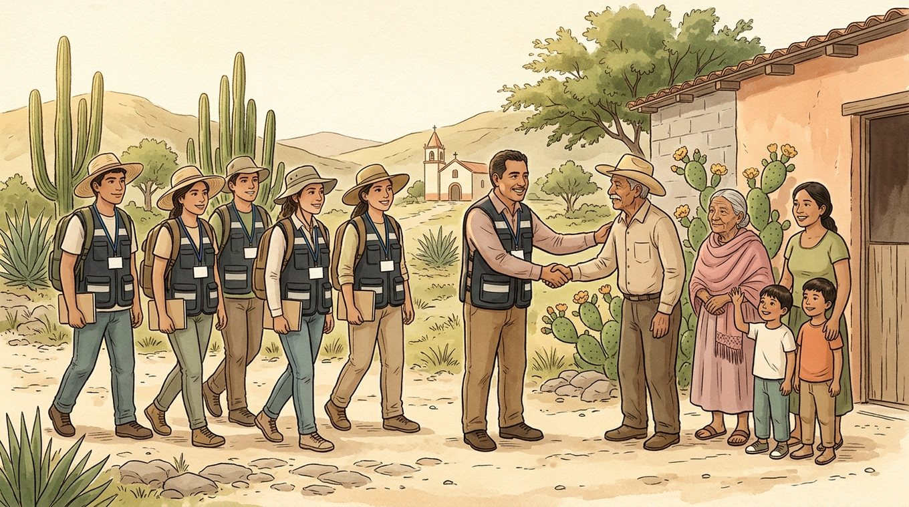
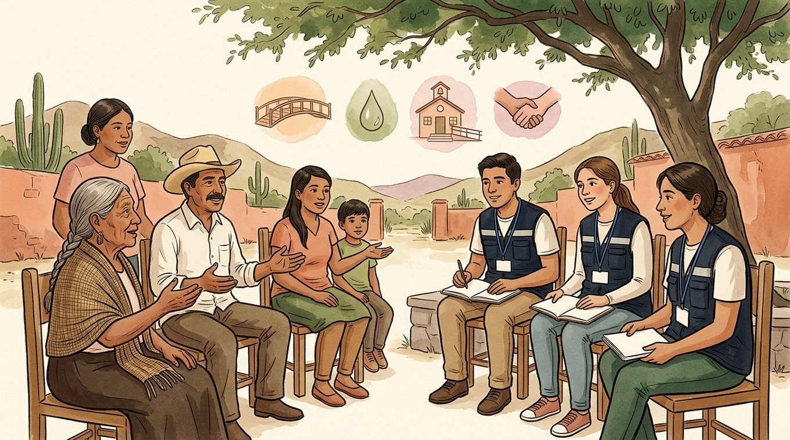
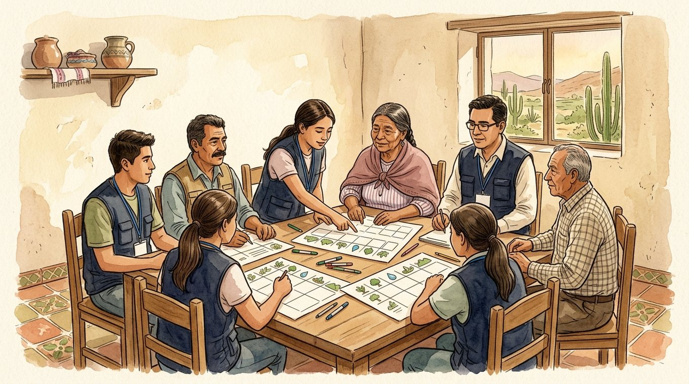
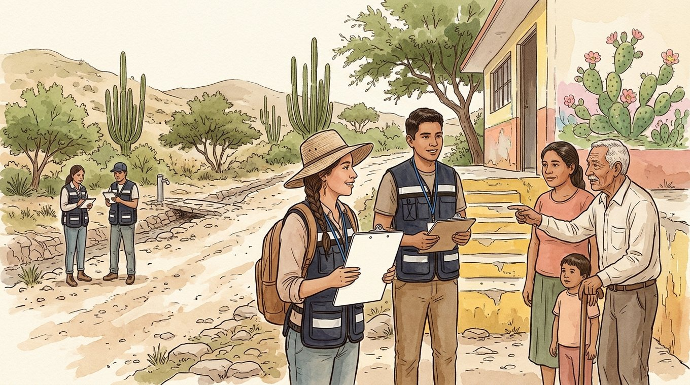
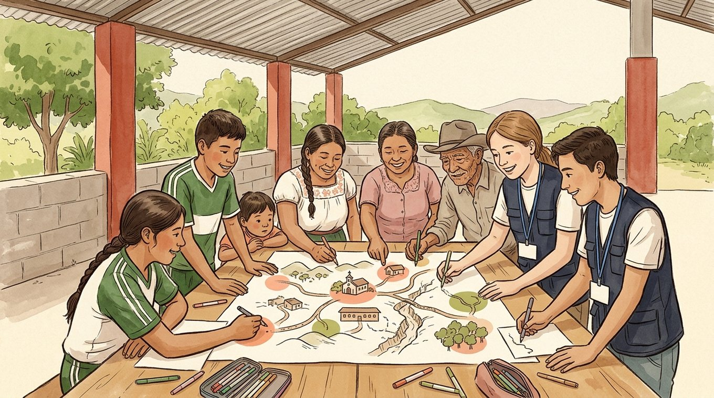
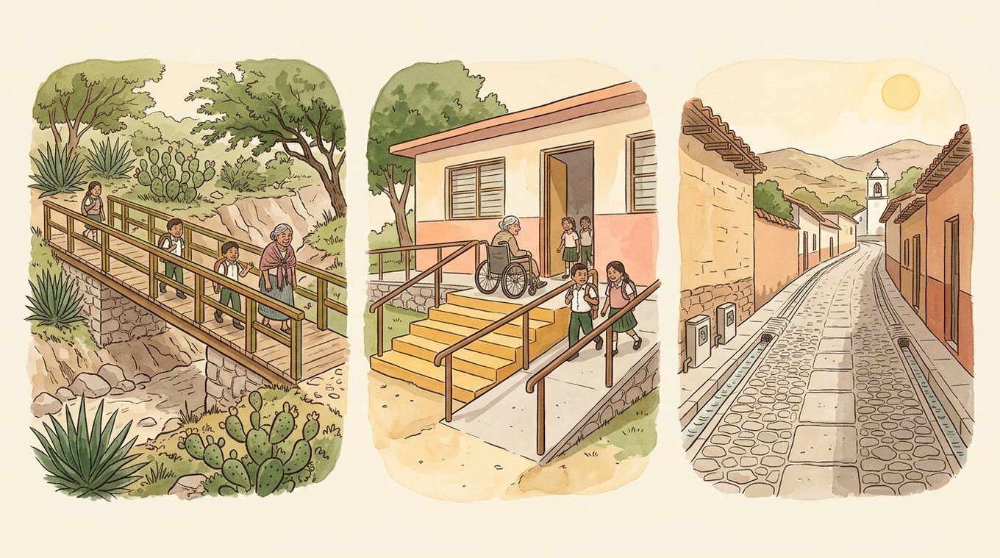
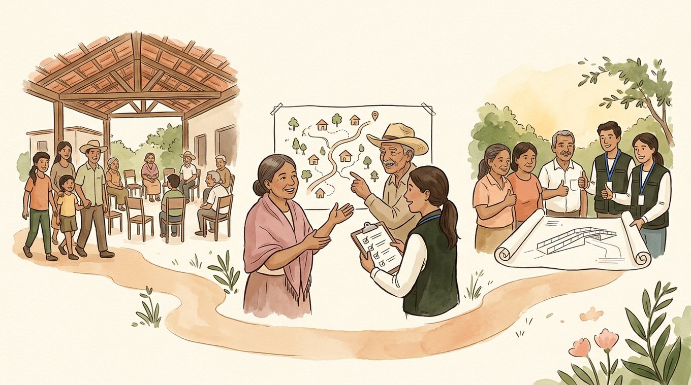
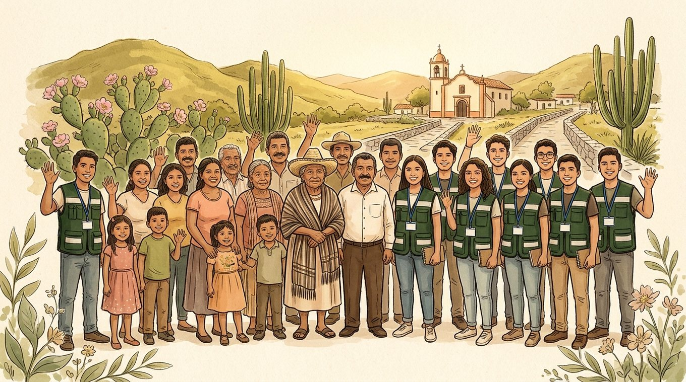

# Storyboard Ilustrado — Diagnóstico Comunitario Participativo (San José Buenavista, Puebla)

- **Institución:** Universidad Intercultural del Estado de Puebla (UIEP) · Ingeniería Civil Sustentable – Vinculación Comunitaria
- **Asesor de Brigada:** Dr. Rogelio Rojas Ramos
- **Integrantes de Brigada (10 estudiantes):** Ricardo Arenas Rodríguez, María Paz Contreras Maceda, Brissa Elizabeth Espíndola López, Leonel Martín López Cuahutle, Rosendo Sánchez Gutiérrez, David Balderas López, Pedro Ángel Cruz Sánchez, Osmar Leyva Flores, Roberto Melchor Velázquez e Isaías Jasciel Zúñiga Sanromán.
- **Público objetivo:** Vecinas y vecinos de todas las edades de San José Buenavista que escanean el código QR desde la lona informativa comunitaria (90 × 120 cm).
- **Paleta y estilo visual:** Ilustración editorial cálida tipo cuaderno de campo y acuarela suave sobre fondo crema (`#FAF3E8`), con acentos en verde bosque/olivo (`#1F4A23`, `#7D9154`), durazno/terracota (`#F1C28B`), rosa pastel (`#F3B8BC`) y café tierra (`#8E6545`).

---

## Escena 1: Bienvenida y conexión con San José Buenavista

- **Descripción visual detallada:** Plano general abierto a nivel de calle bajo la luz cálida de la mañana. Por un camino de tierra y piedra bordeado de nopales en flor, órganos cactáceos y agaves, llega caminando la brigada de estudiantes de Ingeniería Civil Sustentable de la UIEP junto con su asesor, el Dr. Rogelio Rojas Ramos; portan sombreros para el sol, mochilas, cuadernos de campo, gafetes con cordón azul y chalecos oscuros con franjas reflejantes. Frente a una casa sencilla y con los cerros semiáridos y la iglesia comunitaria al fondo, un abuelo con sombrero, una abuelita con rebozo rosa pastel, una madre y dos niños los reciben con un apretón de manos y sonrisas de confianza y hospitalidad.
- **Texto en pantalla:**
  > ¡Hola, vecinas y vecinos de San José Buenavista!
  > Somos estudiantes de la UIEP y venimos a escuchar y aprender con ustedes.
- **Guion de narración o diálogo comunitario:**
  > *Brigada estudiantil UIEP:* «¡Buenos días, vecinas y vecinos! Venimos de la Universidad Intercultural del Estado de Puebla con mucho respeto para caminar su comunidad y trabajar de la mano con ustedes.»
- **Nota de transición o ritmo visual:** Paneo suave siguiendo el saludo de manos hacia el centro del pueblo, fundiéndose con la sombra fresca de un árbol donde inicia la plática vecinal.

---

## Escena 2: ¿Qué es el Diagnóstico Comunitario Participativo?

- **Descripción visual detallada:** Plano medio grupal a la misma altura visual bajo la sombra de un mezquite en una plazuela de la comunidad. Una adulta mayor con rebozo, un vecino campesino con sombrero, una mujer joven y un niño conversan con confianza y gestos abiertos frente a tres jóvenes brigadistas de la UIEP que escuchan con atención y toman notas en sus libretas. En la parte superior flotan delicadas viñetas en acuarela suave (un puente peatonal, una gota de agua, una escuela con rampa y dos manos estrechándose) que simbolizan los temas nacidos de la propia gente. Emoción de empatía, igualdad e interculturalidad.
- **Texto en pantalla:**
  > No es un proyecto impuesto desde afuera:
  > es un trabajo en equipo donde la voz de la comunidad guía las soluciones.
- **Guion de narración o diálogo comunitario:**
  > *Narración comunitaria:* «Nadie conoce mejor San José Buenavista que quienes viven aquí todos los días. Por eso aquí nadie viene a imponer nada: tus ideas y tu palabra son las que marcan el camino.»
- **Nota de transición o ritmo visual:** Disolvencia cálida desde el ícono de las manos unidas hacia una mesa de acuerdos comunitarios en la oficina de las autoridades locales.

---

## Escena 3: Etapa 1 – Nos organizamos con autoridades y comités

- **Descripción visual detallada:** Plano medio amplio en el interior luminoso y sencillo de la oficina comunitaria (con piso de mosaico tradicional, paredes color crema y ventana abierta hacia los cerros y cactáceas de San José Buenavista). Alrededor de una mesa de madera se reúnen autoridades locales, una mujer representante comunitaria, un adulto mayor, el Dr. Rogelio Rojas Ramos y estudiantes de la brigada con sus chalecos y gafetes. Sobre la mesa revisan hojas ilustradas de planeación y calendarios con plumones de colores, señalando acuerdos con gestos de respeto, orden y compromiso compartido.
- **Texto en pantalla:**
  > Etapa 1 · Planeación: Autoridades, comités y brigada UIEP
  > organizamos juntos los talleres y acordamos los temas prioritarios.
- **Guion de narración o diálogo comunitario:**
  > *Representante comunitario:* «Primero nos sentamos entre autoridades locales, comités y la universidad para organizar los talleres y cuidar que todas las familias sean tomadas en cuenta.»
- **Nota de transición o ritmo visual:** Corte dinámico hacia la puerta iluminada por el sol mientras la brigada sale con sus tablillas y encuestas rumbo a las calles de la comunidad.

---

## Escena 4: Etapa 2 – Recorremos calles, caminos y escuelas

- **Descripción visual detallada:** Plano general-medio exterior sobre una calle de tierra y piedra bajo el cielo despejado de San José Buenavista. En primer plano derecho, frente a la escuela comunitaria con escalones amarillos y un mural colorido de nopales en flor, una estudiante con sombrero de ala ancha y un estudiante con tablilla de encuestas escuchan con calidez a una mamá, su hijo pequeño y un abuelito con bastón que señala los escalones y el camino. Al fondo a la izquierda, otros dos brigadistas observan y anotan el estado de una llave de agua y el cruce estrecho de piedra sobre la barranca. Ambiente cercano, respetuoso y atento a la vida cotidiana.
- **Texto en pantalla:**
  > Etapa 2 · Trabajo de campo: Caminamos calles, barrancas y escuelas
  > escuchando tus inquietudes sobre agua, accesibilidad y servicios.
- **Guion de narración o diálogo comunitario:**
  > *Vecina y adulto mayor:* «Los muchachos recorrieron nuestras calles preguntándonos cómo está el agua, los caminos de tierra y lo difícil que es subir los escalones o cruzar en temporada de lluvia.»
- **Nota de transición o ritmo visual:** Acercamiento suave a las hojas de encuesta en la tablilla, que al pasar de viñeta se abren como un gran pliego de papel sobre la mesa del taller comunitario.

---

## Escena 5: Etapa 3 – Dibujamos nuestro mapa social y priorizamos

- **Descripción visual detallada:** Plano picado suave (tres cuartos cenital) bajo el techado comunitario de lámina con columnas color terracota y barda baja de block, rodeado de vegetación y cerros. Alrededor de una larga mesa de madera conviven adolescentes con uniforme deportivo verde con blanco, un niño pequeño, mujeres de la comunidad, un adulto mayor con sombrero y estudiantes de la UIEP. En el centro de la mesa destaca un gran pliego blanco con el mapa social dibujado a mano con plumones: se aprecian la iglesia, la escuela, las veredas, la barranca y círculos en tonos durazno y verde olivo donde las manos de todos señalan prioridades. Emoción de entusiasmo colectivo y unión intergeneracional.
- **Texto en pantalla:**
  > Etapa 3 · Análisis y mapa social: Dibujamos juntos nuestra comunidad
  > para ubicar y dar prioridad a las necesidades más urgentes.
- **Guion de narración o diálogo comunitario:**
  > *Joven de la comunidad:* «¡Entre chicas, chicos, mamás y abuelos dibujamos el mapa de nuestro pueblo y marcamos con colores los puntos donde más urge mejorar!»
- **Nota de transición o ritmo visual:** Los círculos de prioridad dibujados en el mapa cobran vida y se expanden suavemente en tres paneles ilustrados con las propuestas concretas.

---

## Escena 6: Etapa 4 – Propuestas técnicas viables y sustentables

- **Descripción visual detallada:** Composición horizontal tipo tríptico con tres viñetas orgánicas de bordes redondeados sobre papel crema cálido (`#FAF3E8`): (1) A la izquierda, un puente peatonal firme y seguro con barandales sobre la barranca rocosa bordeada de magueyes y nopales, por donde cruzan tranquilos escolares y una abuelita; (2) Al centro, rampas de acceso con pendiente suave y pasamanos junto a los escalones amarillos de la escuela, permitiendo el ingreso digno de una persona mayor en silla de ruedas y niñas y niños; (3) A la derecha, una calle empedrada con materiales regionales mixtos, cunetas pluviales limpias y registros ordenados de agua hacia la iglesia del pueblo. Transmite esperanza práctica, seguridad e inclusión.
- **Texto en pantalla:**
  > Etapa 4 · Propuestas: Puente peatonal seguro, rampas incluyentes
  > en la escuela y mejora sustentable de nuestras calles y servicios.
- **Guion de narración o diálogo comunitario:**
  > *Asesor Dr. Rogelio Rojas Ramos y brigada:* «Con todo lo que la comunidad nos compartió, preparamos propuestas viables y sustentables: un puente peatonal seguro, rampas accesibles en la escuela y calles dignas con materiales de la región.»
- **Nota de transición o ritmo visual:** Desplazamiento fluido hacia adelante siguiendo un sendero color tierra cálida que conecta las tres propuestas con los tres pasos de participación vecinal.

---

## Escena 7: ¿Qué puedes hacer tú como vecina o vecino?

- **Descripción visual detallada:** Ilustración didáctica en tres escenas conectadas por un sendero ondulante sobre fondo crema cálido: (Izquierda – Paso 1) Familias, jóvenes y personas mayores llegando contentos a tomar asiento en círculo bajo el techado comunitario; (Centro – Paso 2) Una vecina con rebozo y un señor con sombrero conversando animadamente, señalando el croquis comunitario mientras una brigadista anota sus propuestas en la encuesta; (Derecha – Paso 3) Vecinas, comité local y dos estudiantes revisando juntos el plano ilustrado de un puente/rampa y levantando el pulgar en señal de aprobación y seguimiento. Ritmo claro, cercano y motivador.
- **Texto en pantalla:**
  > Participa en 3 pasos: 1. Asiste a los talleres · 2. Comparte tus ideas
  > en encuestas y mapas · 3. Ayuda a validar y dar seguimiento.
- **Guion de narración o diálogo comunitario:**
  > *Vecina e integrante de brigada:* «¡Tu participación hace la diferencia! Ven a las reuniones y conversatorios, cuéntanos tus propuestas y acompáñanos a revisar que cada proyecto responda de verdad al pueblo.»
- **Nota de transición o ritmo visual:** Apertura amplia de cámara (zoom out) desde el sendero comunitario hasta revelar a todo el pueblo y la brigada reunidos al atardecer.

---

## Escena 8: ¡Porque juntos construimos un mejor San José Buenavista!

- **Descripción visual detallada:** Gran plano general panorámico y emotivo iluminado por la luz dorada de la tarde. En primer plano, hombro con hombro como una sola gran comunidad, posan sonrientes y saludando niñas, niños, jóvenes, madres, padres, abuelitas con rebozo artesanal, adultos mayores con sombrero, autoridades locales, el Dr. Rogelio Rojas Ramos y la brigada de estudiantes de Ingeniería Civil Sustentable de la UIEP con sus chalecos, gafetes y cuadernos de campo. Detrás de ellos lucen los cerros dorados y verdes, nopales en flor, órganos, caminos empedrados y la iglesia comunitaria, con ramas y hojas verdes enmarcando suavemente las esquinas inferiores igual que en la lona informativa. Emoción de orgullo, gratitud y unidad.
- **Texto en pantalla:**
  > ¡Porque juntos construimos un mejor San José Buenavista!
  > Gracias por abrirnos sus puertas y trabajar en equipo — UIEP.
- **Guion de narración o diálogo comunitario:**
  > *Comunidad y Brigada UIEP en una sola voz:* «¡Muchas gracias, San José Buenavista, por recibirnos con tanta calidez! Escuchándonos y trabajando unidos, sembramos soluciones duraderas para nuestras familias.»
- **Nota de transición o ritmo visual:** Cierre cálido sostenido con disolvencia suave hacia el lema comunitario, los créditos de la brigada universitaria y el emblema oficial de la UIEP.
