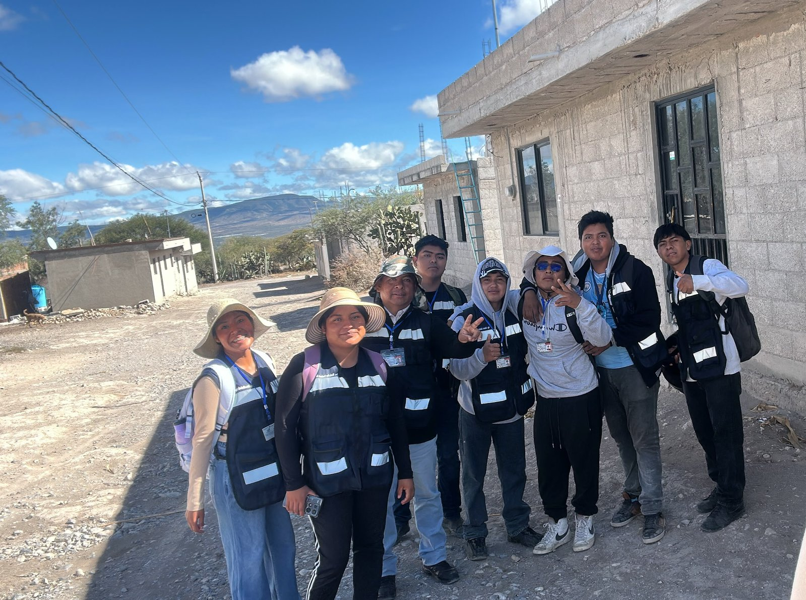
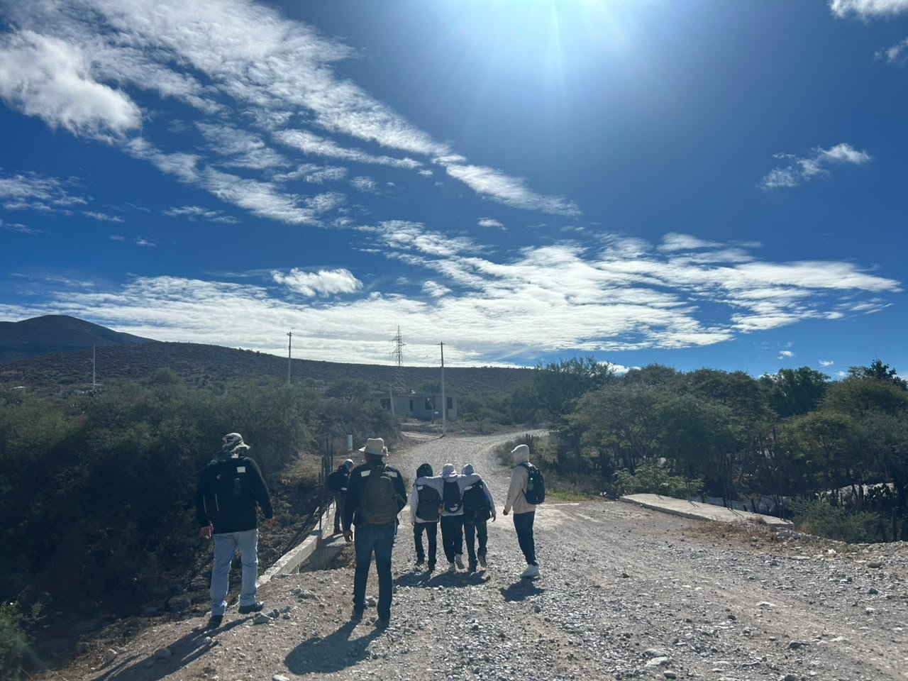
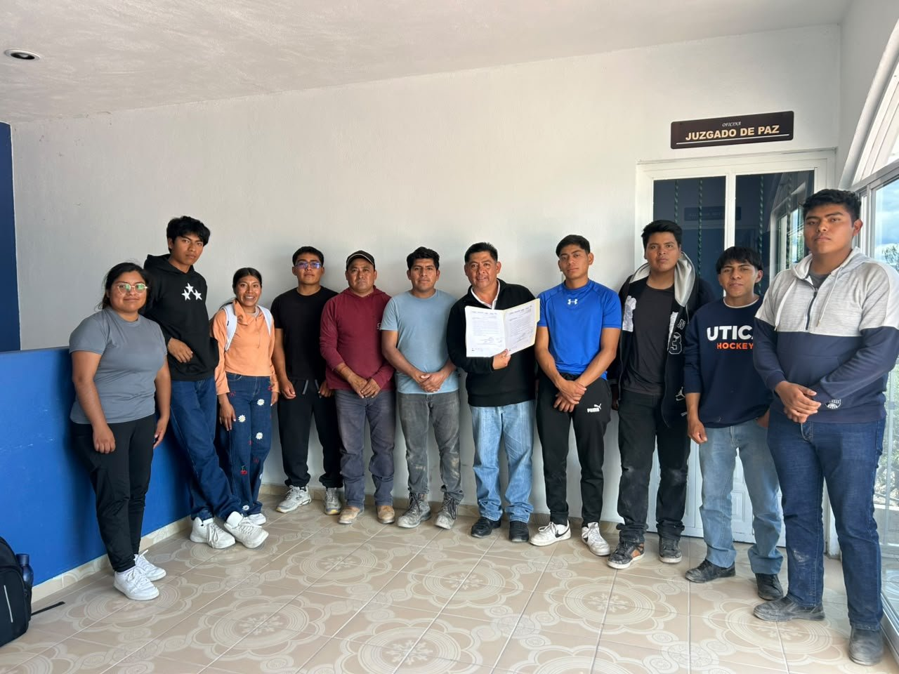
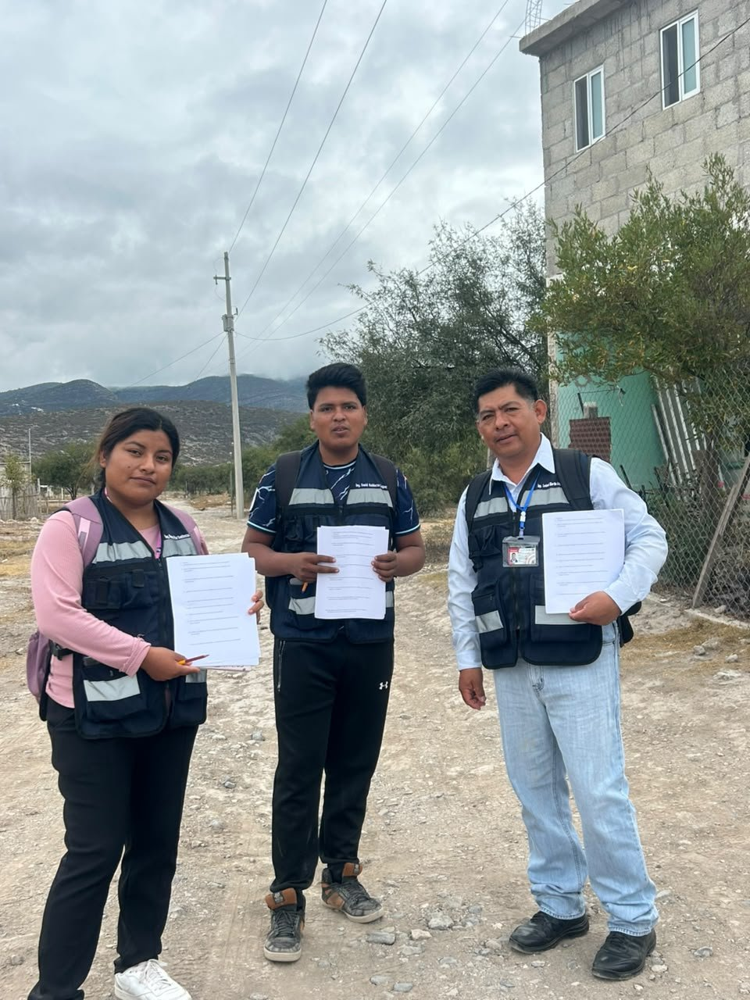
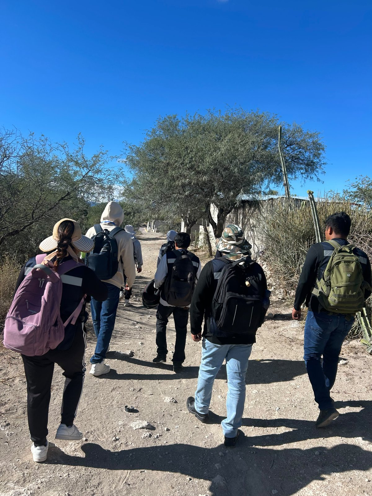
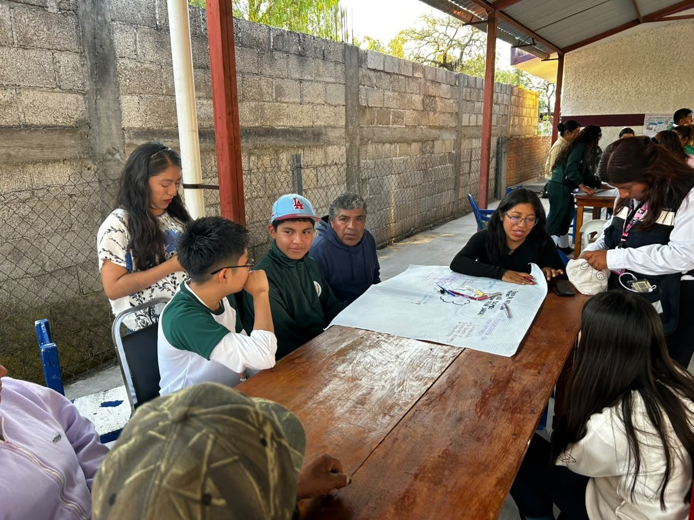
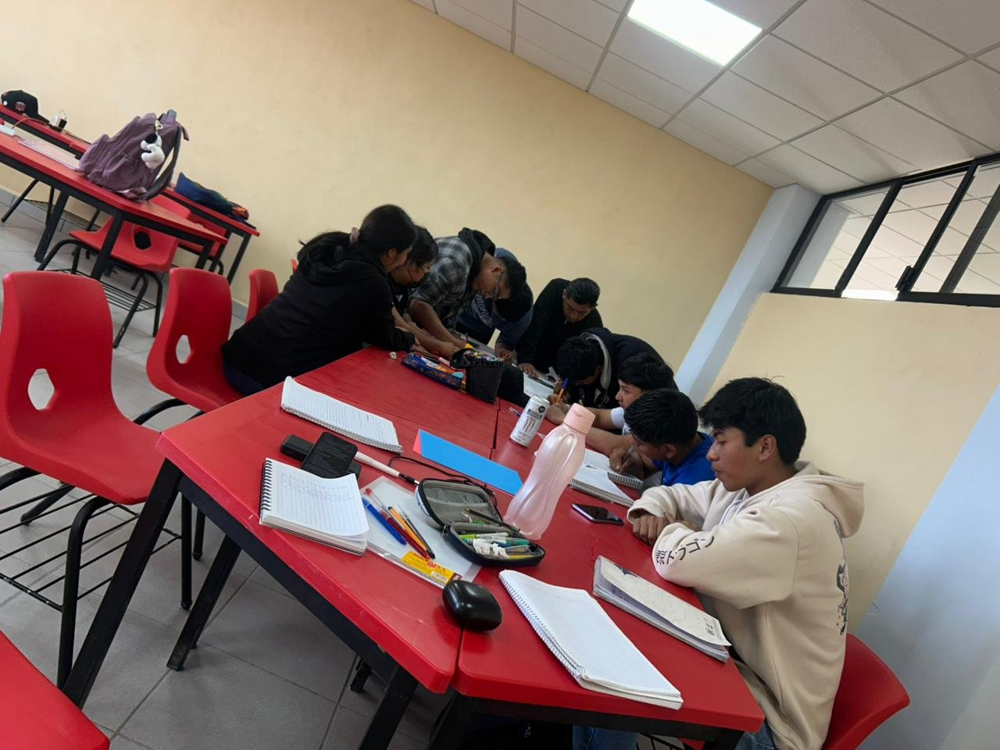
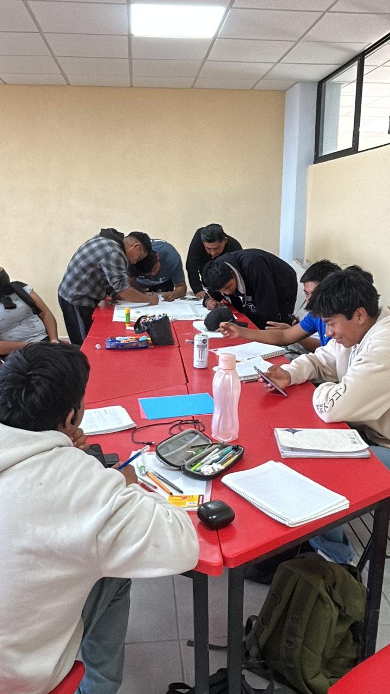
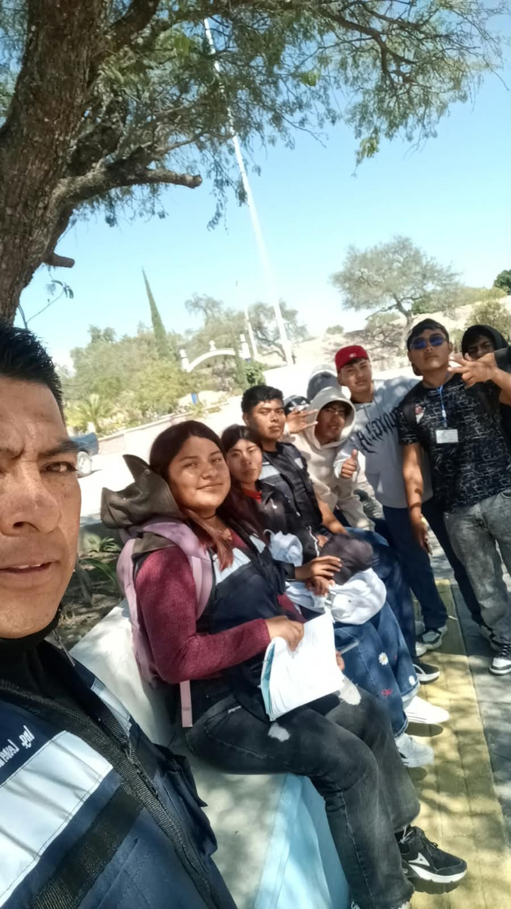
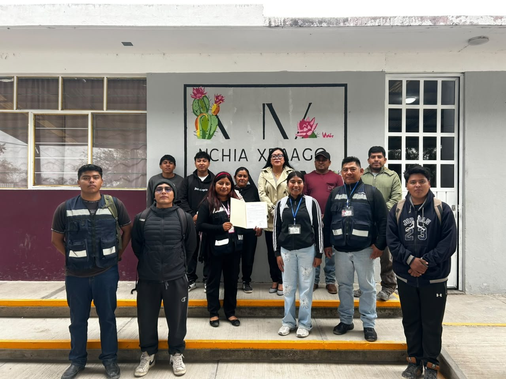

# Memoria y Storyboard Documental — Diagnóstico Comunitario Participativo (San José Buenavista, Puebla)

- **Institución:** Universidad Intercultural del Estado de Puebla (UIEP) · Ingeniería Civil Sustentable – Vinculación Comunitaria
- **Asesor de Brigada:** Dr. Rogelio Rojas Ramos
- **Integrantes de Brigada (10 estudiantes):** Ricardo Arenas Rodríguez, María Paz Contreras Maceda, Brissa Elizabeth Espíndola López, Leonel Martín López Cuahutle, Rosendo Sánchez Gutiérrez, David Balderas López, Pedro Ángel Cruz Sánchez, Osmar Leyva Flores, Roberto Melchor Velázquez e Isaías Jasciel Zúñiga Sanromán.
- **Enfoque:** Mostrar con **fotografías 100 % reales de campo** qué se está haciendo en San José Buenavista y cómo se está llevando a cabo junto con la comunidad.

---

## Paso 01: Presencia en campo y vinculación con San José Buenavista

- **¿Qué se está haciendo?** Acudimos directamente a San José Buenavista para caminar su territorio y escuchar de primera mano a las familias de la comunidad.
- **¿Cómo se está haciendo?** La brigada de 10 estudiantes de Ingeniería Civil Sustentable de la UIEP, asesorada por el Dr. Rogelio Rojas Ramos, visita personalmente las calles de la localidad con respeto e identidad intercultural.
- **Diálogo comunitario:** «Venimos de la Universidad Intercultural del Estado de Puebla a caminar junto con ustedes, conocer su realidad cotidiana y sumar nuestro trabajo técnico al servicio del pueblo.»

---

## Paso 02: ¿Qué es el Diagnóstico Comunitario Participativo?

- **¿Qué se está haciendo?** Realizamos un Diagnóstico Comunitario Participativo: identificamos necesidades reales sin imponer proyectos desde afuera.
- **¿Cómo se está haciendo?** Observamos en sitio el estado real de los caminos, pasos sobre barranca y servicios, combinando la mirada técnica de ingeniería civil sustentable con la experiencia diaria de quienes habitan San José Buenavista.
- **Diálogo comunitario:** «Aquí no traemos decisiones tomadas de antemano: recorremos cada tramo para entender qué pasa en temporada de lluvias y qué obras hacen falta de verdad.»

---

## Paso 03: Etapa 1 – Coordinación con autoridades en el Juzgado de Paz

- **¿Qué se está haciendo?** Etapa 1 · Planeación: Acordamos con las autoridades locales la organización de talleres, recorridos y temas prioritarios.
- **¿Cómo se está haciendo?** Nos reunimos formalmente en el Juzgado de Paz con autoridades y representantes comunitarios para presentar el plan de trabajo, pedir anuencia y asegurar una convocatoria abierta.
- **Diálogo comunitario:** «Todo paso se coordina primero con las autoridades de San José Buenavista para trabajar en orden, con transparencia y tomando en cuenta a toda la población.»

---

## Paso 04: Etapa 2 – Aplicación de encuestas y recorridos a pie

- **¿Qué se está haciendo?** Etapa 2 · Trabajo de campo: Recorremos calles y aplicamos encuestas para registrar problemáticas de caminos, agua, accesos y servicios.
- **¿Cómo se está haciendo?** Caminamos calle por calle con formatos impresos de encuesta y libretas de campo, platicando directamente con vecinas, vecinos y adultos mayores.
- **Diálogo comunitario:** «En cada calle escuchamos opiniones reales sobre el estado de la terracería, el suministro de agua y los puntos donde cuesta más caminar con seguridad.»

---

## Paso 05: Etapa 3 – Mesas participativas de Mapa Social

- **¿Qué se está haciendo?** Etapa 3 · Mapa social: Vecinos, jóvenes y brigada dibujamos juntos el croquis de la comunidad para ubicar las necesidades más urgentes.
- **¿Cómo se está haciendo?** Mediante dinámicas grupales y conversatorios bajo el techado comunitario, habitantes de distintas edades trazan sobre papel bond su propio territorio y señalan prioridades.
- **Diálogo comunitario:** «Alrededor de la misma mesa participan jóvenes, adultos y familias señalando en el mapa dónde están los puntos críticos de la comunidad.»

---

## Paso 06: Organización y análisis técnico de prioridades

- **¿Qué se está haciendo?** Ordenamos toda la información recabada en encuestas y talleres para identificar con claridad las prioridades de San José Buenavista.
- **¿Cómo se está haciendo?** En mesas de trabajo académico revisamos cada encuesta, comentario vecinal y mapa social para clasificar problemáticas y evaluar alternativas viables y sustentables.
- **Diálogo comunitario:** «Cada opinión que nos compartieron en la comunidad se registra y se analiza con cuidado para que las propuestas respondan fielmente a lo que pidió la gente.»

---

## Paso 07: Etapa 4 – Elaboración de propuestas y cómo sumarte

- **¿Qué se está haciendo?** Etapa 4 · Propuestas: Planteamos puente peatonal, rampas en la escuela y mejora sustentable de calles; tu voz valida cada propuesta.
- **¿Cómo se está haciendo?** Elaboramos propuestas preliminares de infraestructura accesible y digna. Cada vecina o vecino puede sumarse en 3 pasos: (1) asistir a talleres, (2) compartir sus ideas y (3) validar y dar seguimiento.
- **Diálogo comunitario:** «Estamos trabajando en opciones concretas como un paso peatonal seguro, rampas incluyentes en la escuela y mejora de vialidades con materiales acordes al entorno.»

---

## Paso 08: Alianza comunitaria y agradecimiento

- **¿Qué se está haciendo?** ¡Porque juntos construimos un mejor San José Buenavista! Agradecemos a la comunidad por abrirnos sus puertas y trabajar en equipo.
- **¿Cómo se está haciendo?** Fortaleciendo el vínculo vivo entre la UIEP y San José Buenavista para impulsar soluciones técnicas con pertinencia social y respeto al territorio.
- **Diálogo comunitario:** «Gracias a cada vecina, vecino, comité y autoridad de San José Buenavista por su confianza y por dejarnos aprender y trabajar hombro con hombro con ustedes.»
